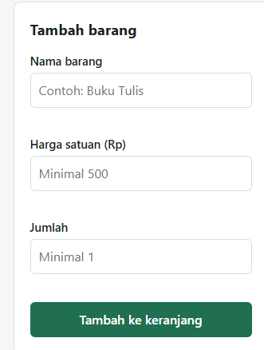
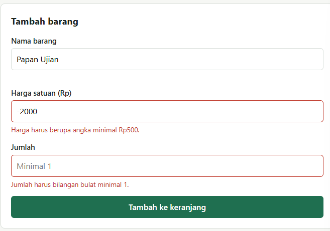
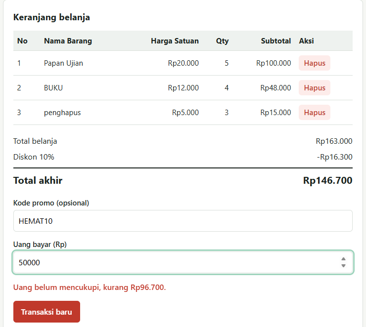

# Mini POS – Kasir & Keranjang Belanja

## Identitas
- Nama Lengkap : Wafi ziqra Maulana
- NIM          : 124140043
- Kelas        : RA

## Deskripsi Aplikasi
Aplikasi web kasir sederhana untuk kantin/toko kampus. Kasir memasukkan barang, aplikasi menghitung subtotal, total, diskon, dan kembalian, lalu menyimpan keranjang di `localStorage` agar tidak hilang saat halaman di-refresh.

## Cara Menjalankan
1. Download atau clone repository ini.
2. Buka folder proyek di VS Code.
3. Klik kanan `index.html` → **Open with Live Server** (atau buka langsung di browser).

## Daftar Fitur
- [x] Validasi nama barang (min. 3 karakter)
- [x] Validasi harga (angka, min. Rp500)
- [x] Validasi qty (bilangan bulat, min. 1)
- [x] Pesan error merah di bawah input; form di-reset jika berhasil
- [x] Subtotal per baris dan total belanja otomatis
- [x] Diskon 10% jika total ≥ Rp50.000 atau memakai kode `HEMAT10`
- [x] Kalkulator uang bayar dan kembalian (ada pesan jika uang kurang)
- [x] Tabel keranjang dengan tombol Hapus
- [x] Penyimpanan keranjang di localStorage
- [x] Tombol Transaksi Baru (kosongkan keranjang dan localStorage)

## Tangkapan Layar

### 1. Tampilan form input utama

### 2. Tampilan saat validasi error

### 3. Tampilan hasil kalkulator dan tabel

## Penjelasan Teknis Singkat
- **Validasi**: `validasiForm()` memeriksa tiap input, menampilkan pesan lewat `setError()`, dan mengembalikan `null` jika ada yang salah sehingga barang tidak masuk keranjang.
- **Kalkulator**: `hitungTotal()` menjumlahkan `harga × qty` semua item. `hitungDiskon()` memberi 10% jika syarat terpenuhi. Kembalian = Uang Bayar − Total Akhir.
- **localStorage**: array `keranjang` diubah ke teks dengan `JSON.stringify()` saat disimpan dan dikembalikan dengan `JSON.parse()` saat halaman dimuat.
