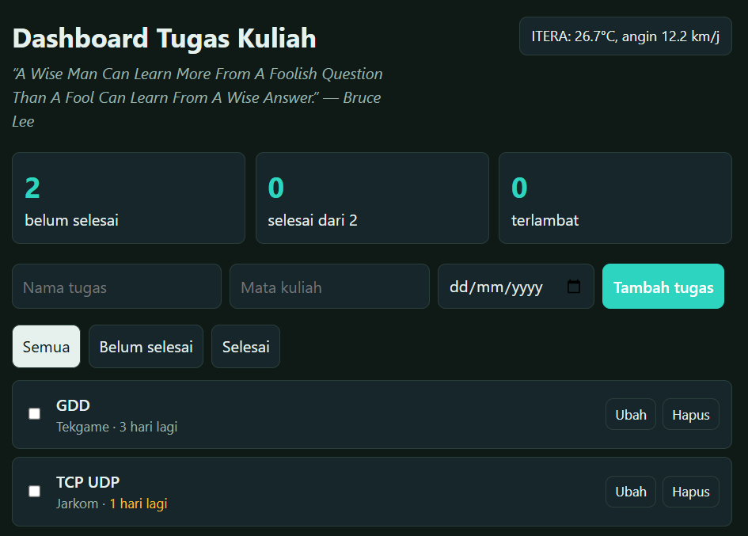

# Dashboard Tugas Kuliah (PAW Pertemuan 2)

## Fungsi aplikasi
Aplikasi untuk mencatat tugas kuliah beserta mata kuliah dan deadline-nya. Data tersimpan di `localStorage`, jadi tidak hilang saat halaman ditutup. Header menampilkan cuaca kampus ITERA dan kutipan harian dari API publik.

## Fitur
- Tambah, ubah, dan hapus tugas
- Tandai tugas selesai, filter (semua / belum selesai / selesai)
- Penghitung sisa hari deadline dan jumlah tugas terlambat
- Cuaca ITERA (Open-Meteo) dan kutipan harian (DummyJSON)
- Tampilan responsif, mendukung mode gelap

## Cara menjalankan
Buka folder `tugas` di VS Code, klik kanan `index.html`, pilih **Open with Live Server** (wajib, karena memakai `type="module"`).

## Screenshot

## Fitur ES6+ yang digunakan
| Fitur | File | Baris |
|---|---|---|
| `let` / `const` | js/main.js | 5, 4 |
| Arrow functions (banyak, mis. `render`, `add`, `remove`) | js/main.js, js/dashboard.js | 39, 54 |
| Template literals | js/main.js | 10, 18 |
| Async/Await | js/dashboard.js | 91, 104 |
| Classes (`TaskItem`, `DashboardApp`) | js/dashboard.js | 3, 28 |
| Destructuring | js/dashboard.js, js/main.js | 96, 11 |
| Spread (state immutable) | js/dashboard.js | 55, 60 |
| Default parameter | js/dashboard.js | 4 |
| ES Modules (`import`/`export`) | js/main.js, js/dashboard.js | 2, 3 |
