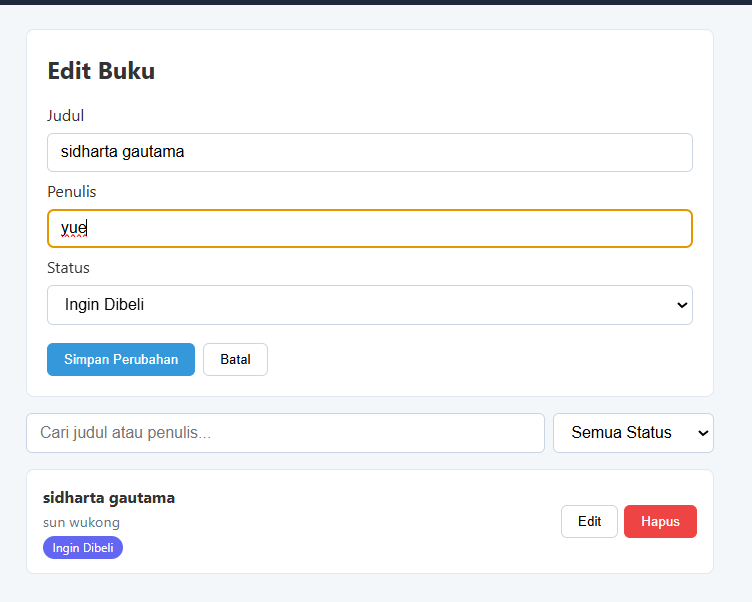
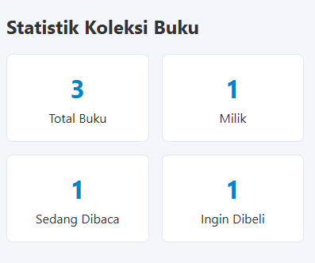
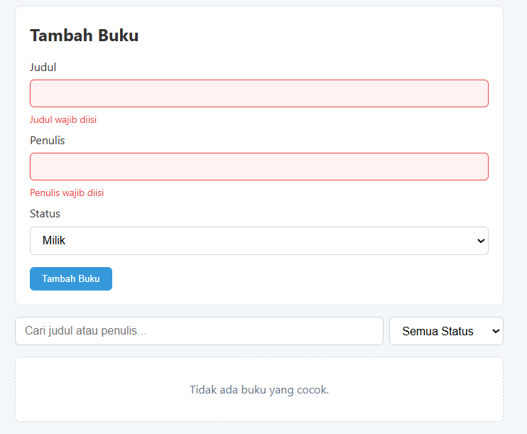

# Aplikasi Manajemen Buku Pribadi

Aplikasi React untuk mencatat buku yang dimiliki, sedang dibaca, atau ingin dibeli.
Dibuat untuk Praktikum PAW 2026/2027 – Pertemuan 3 (React Basics).

## Fitur
- Tambah, edit, dan hapus buku (judul, penulis, status: milik / baca / beli)
- Filter berdasarkan status dan pencarian judul/penulis
- Halaman statistik koleksi
- Validasi form dengan feedback visual (border merah + pesan error)
- Data tersimpan di localStorage

## Instalasi & Menjalankan
```bash
npm install
npm run dev     # buka http://localhost:5173
npm test        # menjalankan unit test
```

## Fitur React yang Digunakan
- **useState & useEffect**: state form/filter; `useEffect` untuk sinkron localStorage dan mengisi form saat edit
- **Context API**: `BookContext.jsx` (BookProvider + hook `useBooks`)
- **React Router**: rute `/`, `/stats`, dan `*` (404)
- **Custom Hooks**: `useLocalStorage`, `useBookStats`
- **Komponen reusable**: BookForm, BookList, BookItem, BookFilter, Navbar
- **PropTypes** pada seluruh komponen yang menerima props
- **Testing**: Vitest + React Testing Library (8 test)

## Screenshot

### Tambah Buku


### Edit Buku


### Statistik


### Validasi Error


